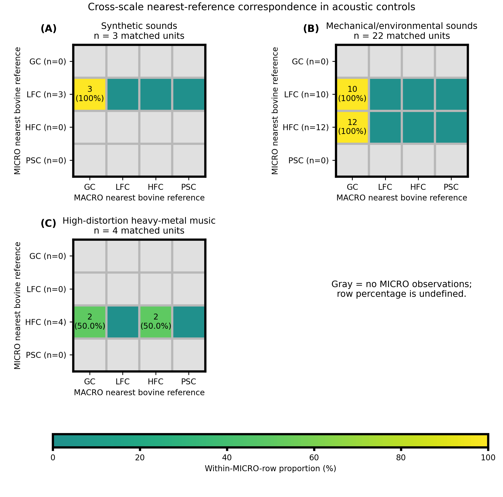
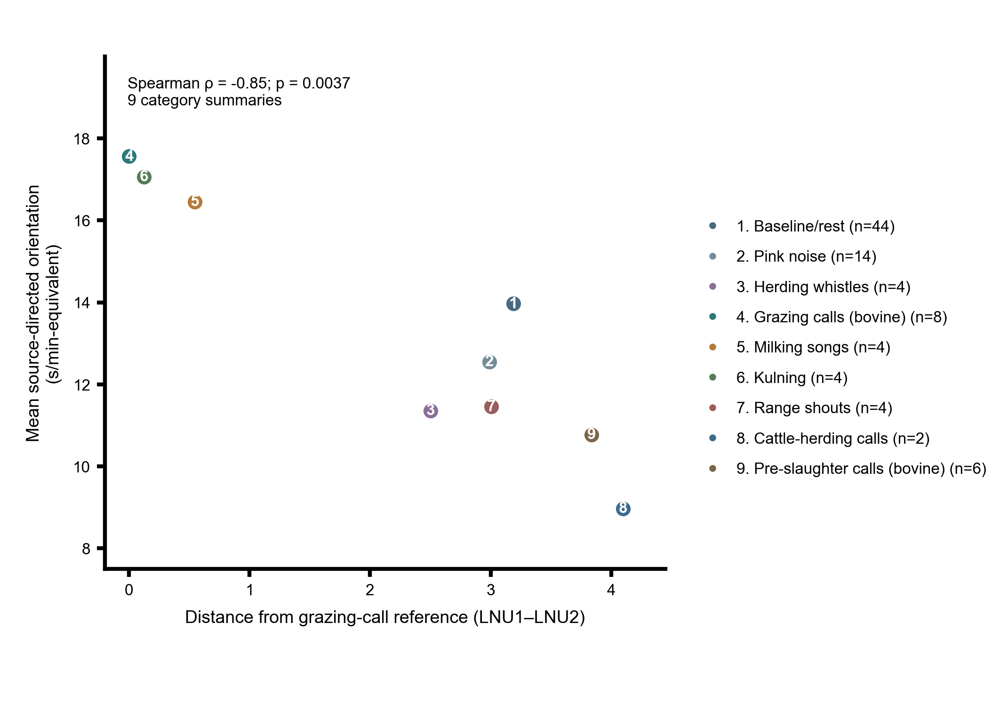
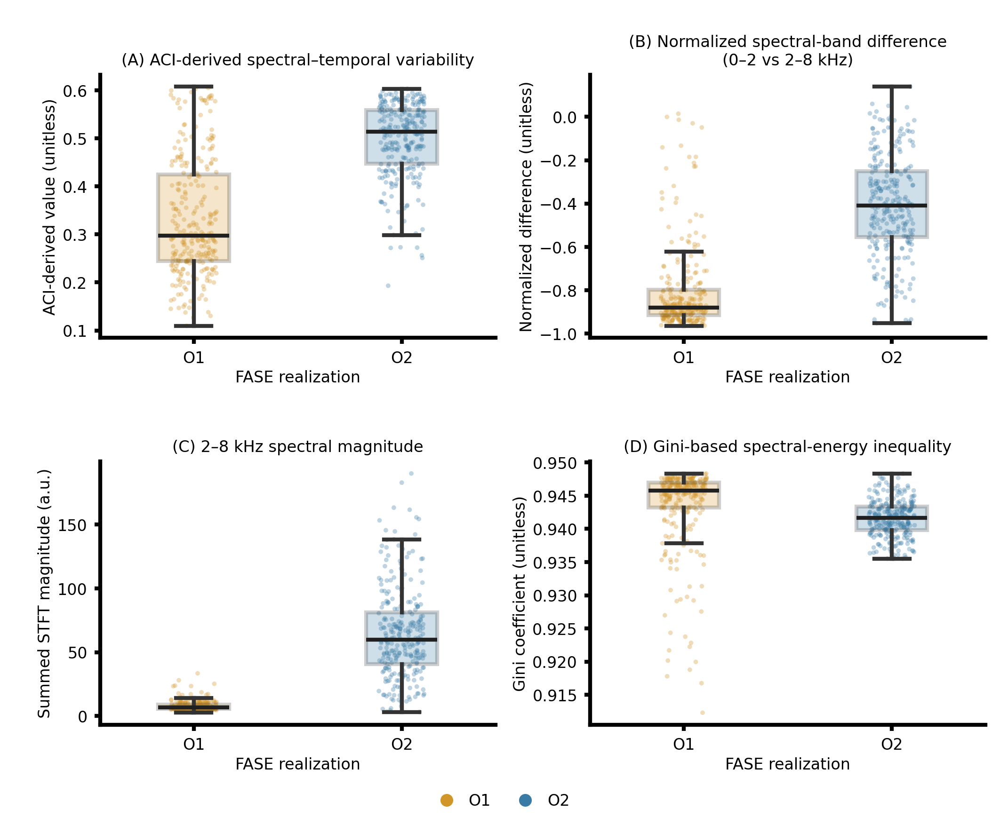
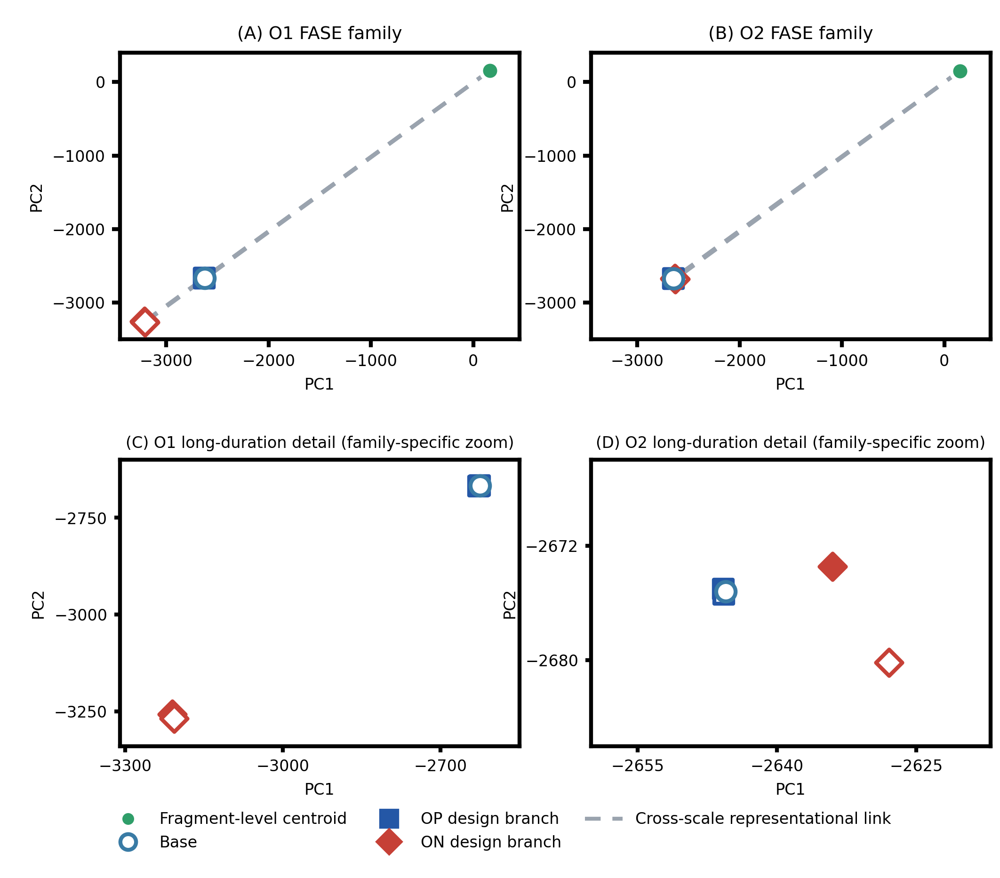
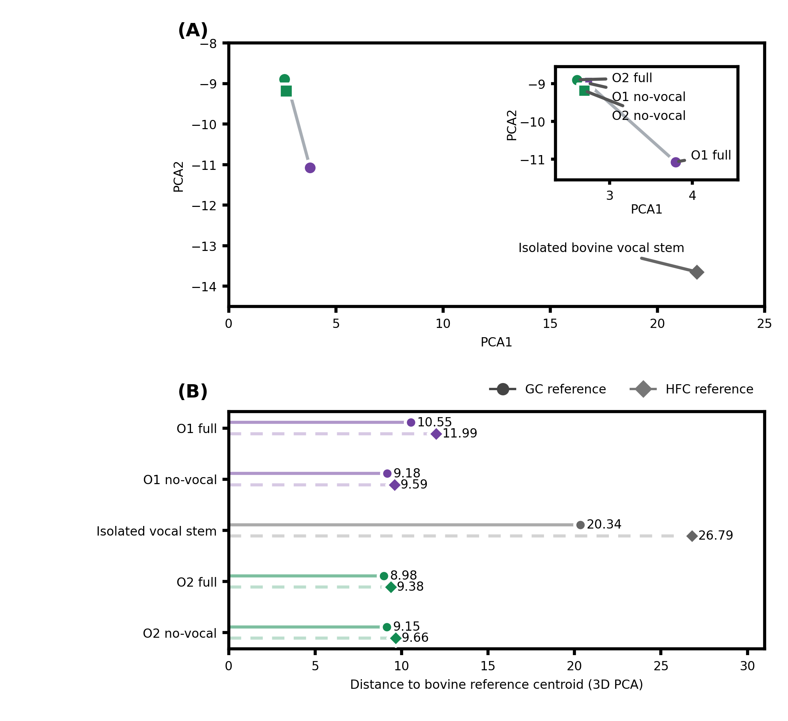

# Supplementary Figures

**Article title:** Affective Information Transmission in Cross-Species Acoustic Communication: Evidence for Multiscale Acoustic–Affective Organization

The figures and captions below are provided as a separate supplementary deliverable.

## Supplementary Figure S1

Supplementary Figure S1. Cross-scale nearest-reference correspondence in acoustic controls. Exact-ID paired nearest-reference classifications for (A) synthetic sounds (3 matched units), (B) mechanical/environmental sounds (22 matched units), and (C) high-distortion heavy-metal music (4 matched units) in the independently fitted MICRO and MACRO representations. Rows show MICRO classes and columns show MACRO classes. The four bovine reference classes are grazing calls (GC), low-frequency calls (LFC), high-frequency calls (HFC), and pre-slaughter calls (PSC). Cell color indicates the percentage of units in each MICRO row assigned to the corresponding MACRO class; annotations give the count and within-row percentage for nonzero cells. Gray rows contain no units, so their row percentages are undefined. The mechanical/environmental subset comprises airplane, chainsaw, engine, hand-saw, helicopter, train, and washing-machine recordings. The figure summarizes descriptive class correspondence between scale-specific representations, not a physical or causal transition. Small subgroup sizes, particularly for the synthetic and heavy-metal subsets, limit generalization.

## Supplementary Figure S2

Supplementary Figure S2. Category-level association between acoustic distance from the bovine grazing-call reference and source-directed orientation during playback. Each point represents one of nine playback-category summaries. Horizontal position is the Euclidean distance between the category-wise median centroid and the grazing-call reference in the LNU1–LNU2 representation underlying Figure 5A; vertical position is mean group-level source-directed orientation across repeated one-minute intervals, expressed on an s/min-equivalent scale. Across the nine category summaries, distance was negatively associated with mean source-directed orientation (Spearman ρ = -0.85, p = 0.0037; n = 9). The association is descriptive at the category level. Numbers in the key give the number of repeated one-minute group-level intervals per category.

## Supplementary Figure S3

Supplementary Figure S3. Window-level acoustic-information profiles of the Obonuco FASE realizations. Distributions of four complementary acoustic-information descriptors for O1 and O2: (A) ACI-derived spectral–temporal variability, (B) normalized spectral-band difference between the 0–2 and 2–8 kHz ranges, (C) 2–8 kHz spectral magnitude, and (D) Gini-based spectral-energy inequality. Each point represents one non-overlapping 5-s analysis window; boxes show the median and interquartile range, and whiskers extend to 1.5 times the interquartile range. The 276 windows per realization were obtained from 13 source fragments and represent 23 min of analyzed signal per work. These repeated windows describe the two FASE realizations and are not independent biological replicates. The descriptors derive from formulations used in ecoacoustic research but are applied here to characterize complementary aspects of spectral–temporal organization; they do not measure biodiversity, ecological quality, or biological abundance. Their differences describe a multidimensional acoustic-information profile rather than a single ranking of overall information or complexity.

## Supplementary Figure S4

Supplementary Figure S4. Cross-scale representation of controlled transformation branches within the Obonuco acoustic families. Principal-component representations of fragment-level centroids and long-duration configurations within the O1 and O2 FASE families. Panels (A) and (B) show each family across the full PC1–PC2 range; panels (C) and (D) enlarge the long-duration configurations using family-specific axis ranges. The points show the fragment-level centroid, the original long-duration configuration (Base), and two controlled acoustic-transformation design branches (OP and ON, each with variants a and b). Dashed lines connect the fragment-level centroid with each long-duration configuration as cross-scale representational links. Filled and open markers distinguish variants a and b. The zoomed axes should not be compared across families. All plotted coordinates are shown without jitter; closely overlapping long-duration configurations retain their source positions. The figure extends the cross-scale representation associated with the controlled-transformation analyses in Figures 9 and 10.

## Supplementary Figure S5

Supplementary Figure S5. Representational comparison of complete, no-vocal, and isolated-vocal Obonuco configurations. (A) Principal-component representation of O1 full, O1 no-vocal, O2 full, O2 no-vocal, and the isolated bovine vocal stem within the OAAS-derived acoustic space. Connections between each full and corresponding no-vocal configuration illustrate representational displacement among alternative compositional configurations; they do not indicate temporal trajectories. The inset enlarges the full and no-vocal configurations using the same coordinates. (B) Distances of the same configurations from the Grazing Call (GC) and High-Frequency Call (HFC) bovine acoustic reference centroids, calculated in the preserved three-dimensional PCA representation. These comparisons characterize relative acoustic correspondence and do not establish affective equivalence, receiver state, welfare outcome, or a causal effect of the vocal component.
